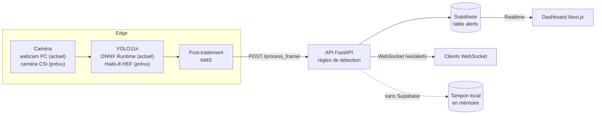

# Smart Surveillance Edge AI

> **In English.** Prototype of an Edge-to-Cloud video surveillance system: YOLO11n object
> detection (ONNX on a PC webcam today, Raspberry Pi 5 + Hailo-8 planned), rule-based detection
> of intrusion, fall, abandoned object and crowding, a FastAPI backend (REST + WebSocket) that
> stores alerts in Supabase, and a real-time Next.js dashboard. Edge deployment and benchmarks
> are not done yet; performance figures below are estimates. Documentation is in French.

Système de surveillance intelligente par caméra, selon une architecture **Edge-to-Cloud** :
la détection tourne au plus près de la caméra, les alertes sont centralisées dans le cloud et
affichées en temps réel.

## Problème

Une caméra de surveillance produit un flux continu que personne ne regarde en permanence.
L'objectif est de détecter automatiquement quelques comportements anormaux et de ne remonter
que des **alertes** structurées, avec une inférence locale (Edge) pour limiter la latence et
la bande passante, et une supervision centralisée (Cloud).

## Fonctionnalités

- **Détection d'objets** YOLO11n (80 classes COCO) exportée en ONNX ; sur PC, inférence via
  ONNX Runtime (DirectML sur GPU Windows, sinon CPU).
- **Analyse comportementale par règles** (`services.py`) : intrusion dans une zone interdite,
  chute possible, objet abandonné, attroupement.
- **API FastAPI** : réception des détections d'une frame, génération des alertes, historique,
  statistiques, flux WebSocket temps réel.
- **Persistance Supabase** (PostgreSQL) ; sans configuration, **mode simulation** avec un
  tampon d'alertes en mémoire.
- **Simulateur** (`simulator.py`) : remplace la caméra et le NPU du Raspberry Pi par la webcam
  du PC et le modèle ONNX, et envoie les détections à l'API.
- **Dashboard Next.js** : cartes de statistiques et liste d'alertes mise à jour par Supabase
  Realtime.

## Architecture



Ce qui tourne aujourd'hui est la **simulation sur PC** (webcam + ONNX). Le déploiement sur
Raspberry Pi 5 + Hailo-8 et le suivi multi-objets BoT-SORT sont **prévus, pas réalisés**
(voir [Avancement](#avancement)).

| Fichier | Rôle |
| --- | --- |
| `main.py` | API FastAPI : routes REST et WebSocket |
| `models.py` | Modèles Pydantic : détections, frames, alertes |
| `services.py` | Règles d'analyse comportementale et seuils |
| `database.py` | Client Supabase, tampon local, diffusion WebSocket |
| `simulator.py` | Pipeline webcam → ONNX → API sur PC |
| `convert_to_onnx.py` | Téléchargement de `yolo11n.pt` et export ONNX (opset 11, 640×640) |
| `test_inference.py` | Démo visuelle : inférence ONNX sur la webcam (pas un test automatisé) |
| `test_pt_vs_onnx.py` | Démo visuelle : comparaison PyTorch / ONNX sur la webcam (pas un test automatisé) |
| `setup.ps1` | Installation et lancement guidés sous Windows |
| `dashboard/` | Dashboard Next.js 16 (React 19, Tailwind CSS 4, Supabase JS) |

### API

| Méthode | Route | Rôle |
| --- | --- | --- |
| `GET` | `/health/` | État du serveur, frames traitées, alertes, clients WebSocket |
| `POST` | `/process_frame/` | Reçoit les détections d'une frame et renvoie les alertes générées |
| `GET` | `/alerts/?limit=50` | Dernières alertes (Supabase ou tampon local), `limit` entre 1 et 200 |
| `GET` / `DELETE` | `/alerts/buffer/` | Lire / vider le tampon local (débogage) |
| `GET` | `/stats/` | Statistiques de traitement |
| `WS` | `/ws/alerts` | Historique récent à la connexion, puis chaque nouvelle alerte |

Documentation interactive : `http://127.0.0.1:8000/docs`.

### Règles de détection

| Comportement | Condition | Seuil (`services.py`) |
| --- | --- | --- |
| Intrusion | Centre de la boîte d'une personne dans `ZONE_INTERDITE` | 40 % gauche de l'image |
| Chute | Ratio largeur / hauteur de la boîte d'une personne | `FALL_RATIO_THRESHOLD = 1.2` |
| Objet abandonné | Sac, sac à main ou valise sans personne à proximité | `ABANDONED_OBJECT_DIST = 120` px |
| Attroupement | Nombre de personnes dans la frame | `CROWD_MIN_PERSONS = 3` |

Seules les détections de confiance ≥ 0,45 (`CONFIDENCE_MIN_DETECTION`) sont prises en compte.

## Résultats

Le dépôt ne contient **aucune mesure réelle** (pas de benchmark, pas de jeu de test annoté) :
aucun chiffre de précision ou de vitesse n'est donc annoncé ici. Les valeurs de la section
suivante sont des estimations.

## Performances (estimations)

| Plateforme | Modèle | FPS estimé |
|---|---|---|
| PC (i7 + RTX) | ONNX (dev) | ~25–35 FPS |
| RPi 5 seul | ONNX | ~6–8 FPS |
| RPi 5 + Hailo-8 | HEF (INT8) | ~25–35 FPS |

Ces valeurs sont des **estimations** fondées sur la documentation du Hailo Model Zoo ; elles
n'ont pas été mesurées. Les latences affichées dans le panneau « Pipeline » du dashboard sont
elles aussi des estimations.

## Sécurité

- **Secrets** : les clés Supabase se placent dans `.env` (API) et `dashboard/.env.local`
  (dashboard), tous deux ignorés par git ; seuls des modèles `.env.example` avec des valeurs
  factices sont versionnés.
- **Clé `service_role` uniquement côté serveur** : l'API l'utilise pour écrire dans Supabase.
  Le dashboard n'utilise que la clé **`anon`**, car les variables `NEXT_PUBLIC_*` sont envoyées
  au navigateur. Ne jamais mettre `service_role` dans le dashboard.
- **RLS** : activer la sécurité au niveau des lignes sur la table `alerts`, avec une politique
  de lecture seule pour le rôle `anon`.
- **API locale** : la documentation la lance sur `127.0.0.1`. Elle n'a **pas
  d'authentification** et son CORS accepte toutes les origines (`allow_origins=["*"]`) : à
  restreindre avant toute exposition réseau.
- **Données personnelles** : le flux vidéo n'est pas stocké ; seules les alertes (type,
  description, boîtes) le sont. Un usage réel d'une caméra doit respecter le droit applicable à
  la vidéosurveillance.

Signaler une faille : [SECURITY.md](SECURITY.md).

## Installation

Prérequis : Python 3.11, Node.js 20+, une webcam pour le simulateur, et un projet Supabase
(gratuit) pour la persistance et le dashboard.

### 1. Cloner le dépôt

```bash
git clone https://github.com/othmane1244/smart-surveillance-edge-ai.git
cd smart-surveillance-edge-ai
```

### 2. API et simulateur (Python)

```bash
python -m venv hailo_env
# Windows
hailo_env\Scripts\activate
# Linux / RPi 5
source hailo_env/bin/activate

pip install -r requirements.txt
python convert_to_onnx.py      # télécharge yolo11n.pt et génère yolo11n.onnx
```

Les modèles `.pt`, `.onnx` et `.hef` ne sont pas versionnés.

Supabase est **optionnel pour l'API** : sans configuration, elle démarre en mode simulation.
Pour activer la persistance, copier `.env.example` en `.env` et renseigner `SUPABASE_URL` et
`SUPABASE_SERVICE_KEY`.

### 3. Table Supabase

Le schéma SQL de la table `alerts` n'est **pas fourni dans le dépôt** (*à compléter*). D'après
`database.py` et `dashboard/lib/supabase.ts`, elle doit contenir les colonnes `id`,
`created_at`, `camera_id`, `alert_type`, `description`, `confidence_score`,
`detection_info` (JSON) et `is_resolved`. Activer Supabase Realtime sur cette table pour que
le dashboard reçoive les insertions.

### 4. Dashboard

```bash
cd dashboard
npm install
cp .env.example .env.local     # puis renseigner l'URL et la clé anon
npm run dev
```

Les deux variables `NEXT_PUBLIC_SUPABASE_URL` et `NEXT_PUBLIC_SUPABASE_ANON_KEY` sont
**obligatoires** : sans elles, le dashboard ne démarre pas (`supabaseUrl is required`).

Sous Windows, `setup.ps1` enchaîne ces étapes et propose de lancer les trois composants :
`powershell -ExecutionPolicy Bypass -File setup.ps1`.

## Lancement (simulation sur PC)

```bash
# Terminal 1 — API
uvicorn main:app --reload --host 127.0.0.1 --port 8000

# Terminal 2 — simulateur (webcam + ONNX ; touche Q pour quitter)
python simulator.py

# Terminal 3 — dashboard
cd dashboard && npm run dev
```

- Swagger : `http://127.0.0.1:8000/docs`
- Alertes en mode simulation : `http://127.0.0.1:8000/alerts/buffer/`
- Dashboard : `http://localhost:3000`

## Limites

- **Pas de déploiement Edge réel** : le Raspberry Pi 5 + Hailo-8 (compilation HEF, HailoRT,
  libcamera) n'est pas encore utilisé ; tout tourne en simulation sur PC.
- **Pas de mesure** : aucune performance ni précision n'a été mesurée (voir les estimations).
- **Pas de suivi multi-objets** : BoT-SORT n'est pas implémenté ; le simulateur envoie comme
  `track_id` l'indice de la détection dans la frame, qui change d'une frame à l'autre.
- **Coordonnées et zone** : les règles supposent une image de 640×640 pixels, alors que le
  simulateur envoie des coordonnées à la résolution de la webcam (par exemple 1280×720). La zone
  d'intrusion et la distance « objet abandonné » ne correspondent donc pas aux valeurs annoncées
  sur une image plus grande.
- **Règles sans mémoire temporelle** : une chute ou un objet abandonné est jugé sur une seule
  frame ; un objet posé un instant ou une personne qui se penche peuvent déclencher une alerte.
- **Dashboard** : il exige Supabase pour démarrer, et la page d'accueil est pré-rendue au
  moment de la compilation (`npm run build`) ; en production, seule la mise à jour Realtime
  rafraîchit la liste.
- **Tests** : `test_inference.py` et `test_pt_vs_onnx.py` sont des démonstrations visuelles sur
  webcam, pas des tests automatisés.

## Avancement

- [x] Phase 1 — Analyse et sélection de la plateforme matérielle
- [x] Phase 2 — Sélection du modèle IA (YOLO11n)
- [x] Phase 3 — Architecture logicielle Edge-to-Cloud
- [x] Phase 4 — Conversion du modèle, API FastAPI, Supabase
- [x] Phase 5 — Dashboard Next.js
- [ ] Phase 6 — Déploiement sur Raspberry Pi 5 + Hailo-8 (en attente du matériel)
- [ ] Phase 7 — Tests et benchmarks réels

## Contexte

Projet du module « Apprentissage par projet (APP) », cycle ingénieur IA & Cybersécurité (ENSA
Béni Mellal), année universitaire 2025-2026, réalisé en binôme. Le prototype fonctionne en
simulation sur PC ; le déploiement sur Raspberry Pi 5 + Hailo-8 est la cible prévue.

## Licence

MIT, voir [LICENSE](LICENSE).
